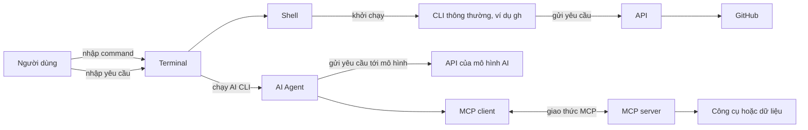

# Bài 5 — CLI, API, MCP và AI Agent

## A. Các khái niệm

### CLI, terminal, shell và command

CLI (Command-Line Interface) là cách dùng phần mềm bằng cách nhập lệnh và đọc kết quả dạng chữ. Terminal là cửa sổ để nhập và xem chữ; shell là chương trình trong terminal đọc lệnh rồi chạy chương trình tương ứng. Một command là chỉ dẫn cụ thể, chẳng hạn `gh --version` yêu cầu GitHub CLI in phiên bản. Ví dụ đời thường: terminal giống quầy giao dịch, shell nhận và chuyển yêu cầu, còn command là phiếu yêu cầu mình đưa cho nhân viên.

### API

API là tập quy tắc để hai chương trình trao đổi dữ liệu hoặc yêu cầu dịch vụ với nhau. Chương trình gửi yêu cầu theo định dạng quy định, còn dịch vụ trả dữ liệu hoặc kết quả; API không nhất thiết là giao diện mà người dùng trực tiếp nhìn thấy. Ví dụ, ứng dụng đặt đồ ăn gọi API để lấy danh sách nhà hàng rồi gửi yêu cầu tạo đơn. GitHub CLI cũng gọi API của GitHub khi cần đọc hoặc thao tác với thông tin trên GitHub.

### MCP

MCP (Model Context Protocol) là một chuẩn mở giúp ứng dụng AI kết nối với dữ liệu, công cụ và dịch vụ bên ngoài theo cách thống nhất. Có thể hình dung MCP như USB-C cho AI: nhiều ứng dụng AI và công cụ có thể kết nối theo cùng một giao thức, nhưng đây chỉ là phép so sánh, không phải cổng kết nối vật lý. Chẳng hạn, AI có thể dùng một MCP server để truy cập tài liệu hoặc gọi một công cụ, nếu người dùng đã cho phép. MCP hỗ trợ việc kết nối; nó không tự làm cho mọi hành động trở nên an toàn hay tự cấp quyền truy cập.

### AI Agent và chatbot trên web

Chatbot thường tập trung trả lời bằng nội dung hội thoại, còn AI Agent có thể lập kế hoạch và dùng công cụ để thực hiện nhiều bước rồi báo lại kết quả. Tùy ứng dụng và quyền được cấp, Agent có thể đọc tệp, chạy lệnh hoặc gọi API/MCP server. Ví dụ, thay vì chỉ gợi ý lịch học, một Agent được cấp quyền phù hợp có thể kiểm tra lịch rồi tạo sự kiện. Cần xem xét và phê duyệt hành động của Agent, nhất là khi hành động có thể sửa hoặc xóa dữ liệu.

### Sơ đồ quan hệ

Terminal là nơi nhập và xem lệnh; shell khởi chạy CLI. Một CLI thông thường như `gh` có thể gọi API của dịch vụ. Với AI CLI, Agent có thể gọi API của mô hình AI và kết nối tới công cụ/dữ liệu qua MCP nếu ứng dụng hỗ trợ và người dùng cấp quyền.

## B. So sánh một số CLI

| Công cụ | Dùng để làm gì |
|---|---|
| Git CLI (`git`) | Quản lý phiên bản mã nguồn trên máy: theo dõi thay đổi, tạo commit và đồng bộ nhánh với kho Git từ xa. Git là công cụ quản lý mã nguồn, không phải giao diện chuyên biệt để quản lý issue hoặc pull request trên GitHub. |
| GitHub CLI (`gh`) | Làm việc với GitHub từ terminal, ví dụ repository, issue, pull request và GitHub Actions. Đây là CLI cho dịch vụ GitHub; một số thao tác tài khoản/API cần đăng nhập. |
| Gemini CLI | AI Agent mã nguồn mở của Google dùng Gemini trong terminal để hỗ trợ các tác vụ lập trình và làm việc với dự án. |
| Claude Code | Công cụ lập trình dạng Agent của Anthropic; có thể đọc codebase, sửa tệp, chạy lệnh và hỗ trợ quy trình phát triển. |
| Codex CLI | Công cụ của OpenAI để đọc, chỉnh sửa và chạy code từ terminal; có thể dùng cho tác vụ lập trình trong kho mã nguồn. |
| GitHub Copilot CLI (`copilot`) | Dùng Copilot trong terminal để hỏi đáp, viết/gỡ lỗi code và tương tác với GitHub; cần xác thực Copilot để dùng các tính năng AI. Đây là công cụ riêng với GitHub CLI (`gh`). |

## C. Cài đặt và dùng thử

### Lựa chọn

Em chọn GitHub CLI (`gh`) vì bài tập đang làm trong GitHub, và công cụ này giúp thao tác với repository, issue và pull request từ terminal. Em cài bằng WinGet cho tài khoản Windows hiện tại. Các lệnh xem phiên bản và trợ giúp dùng được mà không cần đăng nhập; những thao tác cần truy cập tài khoản hoặc API yêu cầu xác thực.

### Ba lệnh đã chạy

| Lệnh | Kết quả thực tế |
|---|---|
| `gh --version` | Chạy thành công; hiển thị `gh version 2.106.0 (2026-11-25)`. |
| `gh help` | Chạy thành công; hiển thị các nhóm lệnh như `repo`, `issue`, `pr`, `run` và `workflow`. |
| `gh repo --help` | Chạy thành công; hiển thị cách dùng và các lệnh quản lý repository. |

### Lỗi gặp phải và cách xử lý

- Trong terminal đang mở, gọi `gh` theo tên lệnh chưa hoạt động vì PATH của tiến trình chưa nhận cập nhật sau khi cài. Em dùng trực tiếp đường dẫn đến `gh.exe` để kiểm tra; sau khi mở terminal mới hoặc khởi động lại VS Code, thử gọi `gh --version` để xác nhận PATH đã được làm mới.
- Lệnh đọc repository bằng `gh api` dừng với thông báo cần chạy `gh auth login`. Em không đăng nhập hoặc cung cấp token thay người dùng; thay vào đó hoàn thành phần dùng thử bằng ba lệnh phiên bản/trợ giúp không cần tài khoản. Nếu cần truy cập API, chủ tài khoản có thể tự chạy `gh auth login` trong terminal và làm theo luồng xác thực chính thức.
- Em cũng thử Copilot CLI nhưng yêu cầu tạo `hello.md` không chạy được vì CLI chưa có thông tin xác thực. Vì bài thực hành chọn GitHub CLI chứ không chọn AI CLI, chưa tạo `hello.md` và không bịa thông tin giới thiệu cá nhân.

### Ưu và nhược điểm

**Ưu điểm:** Thao tác bằng lệnh nhanh, dễ lặp lại và có thể kết hợp trong quy trình tự động. `gh` gom các thao tác GitHub vào terminal, phù hợp khi đang làm việc trong repository.

**Nhược điểm:** Người dùng phải nhớ cú pháp; lệnh liên quan đến tài khoản/API cần xác thực và có thể không dùng được nếu PATH chưa cập nhật. Kết quả chủ yếu là chữ nên người mới có thể khó hình dung hơn giao diện đồ họa; cần đọc kỹ trước khi chạy lệnh có khả năng thay đổi dữ liệu.

### Ảnh chụp màn hình cần tự bổ sung

Ảnh chụp thật chưa được tạo trong tài liệu này. Mở terminal tích hợp trong VS Code, chạy lại ba lệnh trong bảng và tự chụp màn hình phần kết quả. Sau đó thay các dòng dưới đây bằng ảnh chụp thật; không chụp hoặc chia sẻ token, thông tin đăng nhập hay dữ liệu cá nhân không cần thiết.

- **[Chèn ảnh 1: `gh --version` trong terminal VS Code]**
- **[Chèn ảnh 2: kết quả `gh help` và `gh repo --help` trong terminal VS Code]**

## Nguồn tham khảo chính thức

- [GitHub CLI Manual](https://cli.github.com/manual/)
- [GitHub Copilot CLI](https://docs.github.com/en/copilot/how-tos/copilot-cli)
- [Gemini CLI — kho mã nguồn chính thức](https://github.com/google-gemini/gemini-cli)
- [Claude Code — Overview](https://code.claude.com/docs/en/overview)
- [OpenAI Codex CLI](https://developers.openai.com/codex/cli/)
- [Model Context Protocol — Introduction](https://modelcontextprotocol.io/introduction)
